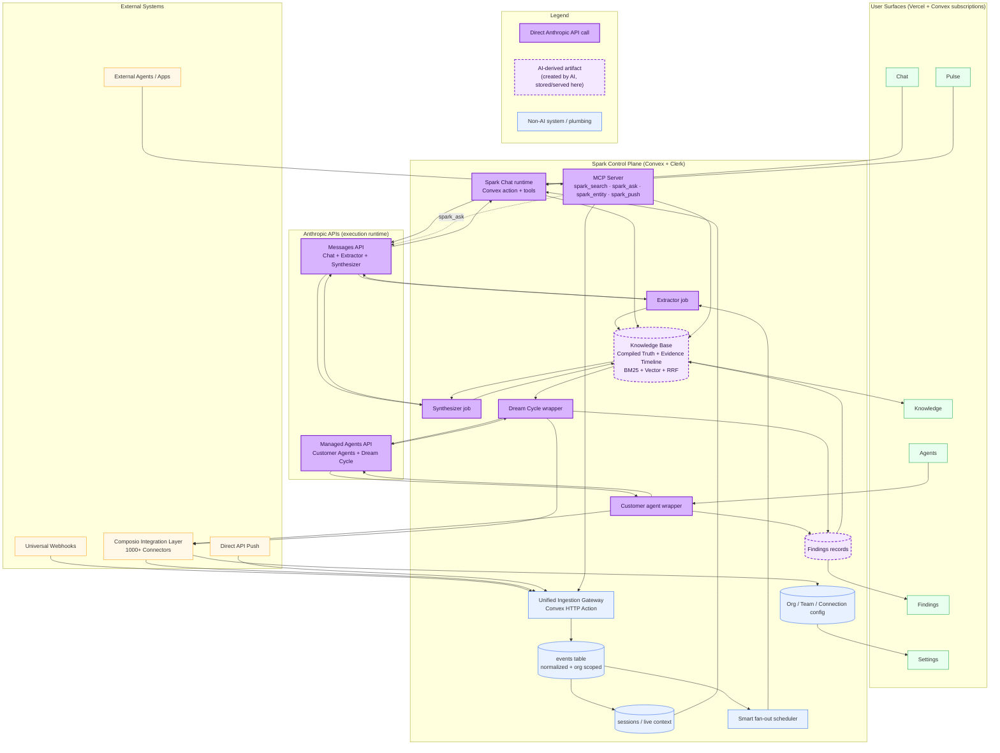
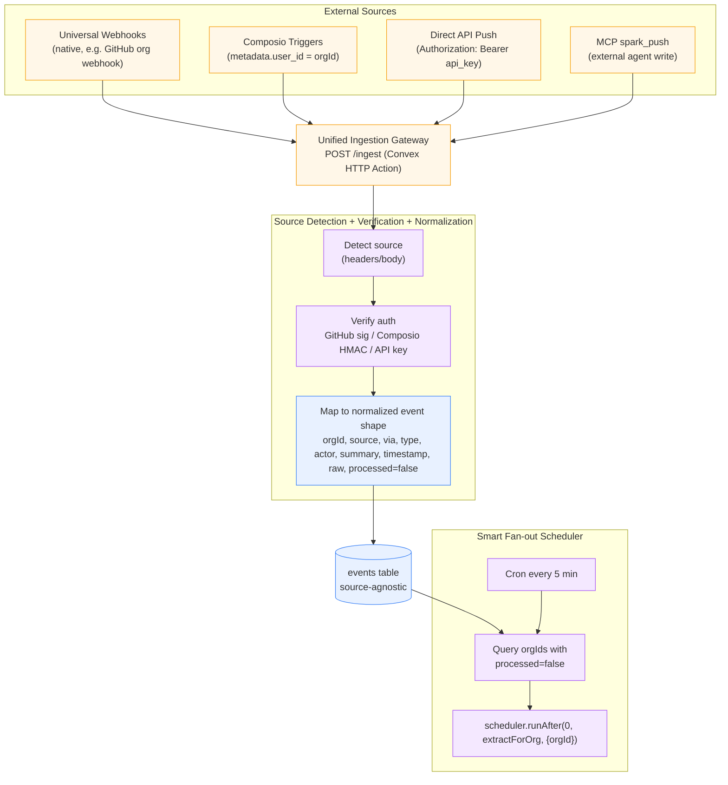

<a id="readme-top"></a>

<p align="center">
  <a href="./docs/assets/spark-birdeye.png">
    
  </a>
</p>

<h1 align="center">Spark</h1>

<p align="center">
  <strong>Your company, as an MCP server.</strong><br>
  <sub>Signals flow in from where your team already works. A knowledge base writes itself, with a citation on every claim. A reasoning engine tells you things nobody asked. You talk to all of it from the AI you already use — Claude, Cursor, any MCP client.</sub>
</p>

<p align="center">
  <a href="./LICENSE"></a>
  <a href="https://github.com/joshdayorg/spark/actions/workflows/ci.yml"></a>
  
  
  
</p>

<p align="center">
  <a href="#connect-your-ai">Connect your AI</a> •
  <a href="#what-ships-today">What ships today</a> •
  <a href="#quick-start">Quick start</a> •
  <a href="#architecture">Architecture</a> •
  <a href="#integrations">Integrations</a> •
  <a href="#contributing">Contributing</a> •
  <a href="https://joshday.org/spark">Why Spark exists</a>
</p>

---

> [!IMPORTANT]
> **Spark is headless.** This repository is the product core: the Convex backend, the intelligence pipeline, and an MCP server that makes your org queryable from any AI client. There is no web app in this repo; admin works from the command line ([Headless admin](./SETUP.md#10-headless-admin-no-frontend-required)). You self-host it on your own Convex, Clerk, Anthropic, OpenAI and Composio accounts — plan on **about an hour** of vendor setup. See [what ships and what doesn't](#what-ships-today).

<a id="what-is-spark"></a>

## 💡 What is Spark

A company is an organism. Every commit, message, ticket and decision encodes how it thinks — but that intelligence is scattered across dozens of tools and fades as fast as it forms. Spark wires into the systems your team already uses and turns the raw signal stream into a living, cited, self-updating understanding of the organization. No adoption required. No behavior change.

The loop is **Sense → Think → Reflect → Act**:

1. **Sense** — GitHub, Slack, Asana, Gorgias and any API push land in one org-scoped `events` table.
2. **Think** — an extractor clusters events into work sessions and writes knowledge pages: **Compiled Truth** (rewritable AI synthesis) on top, an append-only **Evidence Timeline** underneath.
3. **Reflect** — daily, weekly and monthly synthesis, plus an overnight **Dream Cycle** that reads the whole knowledge base and writes *findings*: contradictions, stale decisions, blind spots.
4. **Act** — you ask, search and push from any MCP client; agents you describe in plain English run on the same knowledge.

Findings feed back into the knowledge base, so each cycle starts richer than the last. That is the compounding. The long version of *why* lives in the essay **[Why Spark exists](https://joshday.org/spark)**.

<p align="right">(<a href="#readme-top">back to top</a>)</p>

<a id="connect-your-ai"></a>

## 🔌 Connect your AI

This is the point of Spark: once your deployment is running, your company is on the other end of an MCP connection.

```text
You   › What did we decide about checkout payments, and has anything changed since?

Spark › Checkout payments go through Stripe Connect [Checkout Payments Decision].
        The decision dates from February; the March migration PRs moved the
        webhook handlers to the extensions API [Checkout Extensions Migration].
        No later evidence reverses it.
```

<sub>Illustrative exchange with a fictional org. `spark_ask` answers **only** from your org's knowledge pages, cites them inline as `[title]`, and says what is missing instead of guessing.</sub>

**1. Get an org API key** (after [SETUP](./SETUP.md) — prints the key once):

```bash
npx convex run debug:yellow2aCreateApiKey '{"orgId":"<orgId>","label":"my-laptop"}'
```

**2. Point your client at `https://<deployment>.convex.site/mcp`** (Streamable HTTP, bearer auth):

<details open>
<summary><strong>Claude Code</strong></summary>

```bash
claude mcp add --transport http spark https://<deployment>.convex.site/mcp \
  --header "Authorization: Bearer <org-api-key>"
```

</details>

<details>
<summary><strong>Cursor</strong> (<code>.cursor/mcp.json</code>)</summary>

```json
{
  "mcpServers": {
    "spark": {
      "url": "https://<deployment>.convex.site/mcp",
      "headers": { "Authorization": "Bearer <org-api-key>" }
    }
  }
}
```

</details>

<details>
<summary><strong>Stdio-only clients</strong> (for example Claude Desktop's config file), via <a href="https://www.npmjs.com/package/mcp-remote"><code>mcp-remote</code></a></summary>

```json
{
  "mcpServers": {
    "spark": {
      "command": "npx",
      "args": ["-y", "mcp-remote", "https://<deployment>.convex.site/mcp",
               "--header", "Authorization:${SPARK_AUTH}"],
      "env": { "SPARK_AUTH": "Bearer <org-api-key>" }
    }
  }
}
```

</details>

<details>
<summary><strong>No client — plain HTTP</strong></summary>

The same endpoint also accepts a simple `{tool, input}` JSON body, which is handy for scripts and smoke tests:

```bash
curl -s https://<deployment>.convex.site/mcp \
  -H "Authorization: Bearer <org-api-key>" -H "content-type: application/json" \
  -d '{"tool":"spark_search","input":{"query":"checkout payments"}}'
```

</details>

**3. Use the four tools:**

| Tool | Input | What you get |
|------|-------|--------------|
| `spark_search` | `query` | Top knowledge pages from hybrid search (BM25 + vector + rank fusion + optional rerank), with Compiled Truth and highlights |
| `spark_ask` | `question` | A cited answer grounded only in your knowledge pages |
| `spark_entity` | `entityId` (slug or name) | A person or entity profile: Compiled Truth plus recent evidence |
| `spark_push` | `source`, `type`, `actor`, `summary` (+ optional `timestamp`, `sourceDeliveryId`) | Writes a signal into the same pipeline as every other source |

Keys are stored as SHA-256 hashes, scoped to one org, revocable, and rate-limited per key. Browser origins other than localhost are denied unless you list them in `MCP_ALLOWED_ORIGINS`; desktop and CLI clients are not affected.

<p align="right">(<a href="#readme-top">back to top</a>)</p>

<a id="what-ships-today"></a>

## ✅ What ships today

Everything below is in `main` and pinned by the [proof gate](#proof-gate):

| Pillar | What it does | Where it lives |
|--------|--------------|----------------|
| **📥 Ingestion** | One `POST /ingest` endpoint, three pipes (GitHub App webhooks, Composio triggers, bearer-key API push), one normalizer, one org-scoped `events` table. Idempotent by provider delivery ID. | `convex/ingest.ts`, `convex/http.ts` |
| **📚 Knowledge** | Sessions and pasted/URL sources → markdown-aware chunking → AI context prefixes → single-call extraction → 9 page types with versions, attributions and typed cross-references. Live BM25 search plus hybrid deep search. | `convex/knowledge.ts`, `convex/search.ts` |
| **🔭 Observatory** | The intelligence that comes to you. Daily → weekly → monthly synthesis crons; the overnight Dream Cycle, a Managed Agent that writes up to 7 findings per run across 7 types (contradiction, strategic gap, resource drift, emerging capability, stale decision, unanswered question, blind spot); and Pulse, a four-question briefing (*what changed / why / so what / now what*) cached for 30 minutes. | `convex/spark.ts`, `convex/dreamCycle.ts` |
| **🤖 Agents** | Plain-English agents with a full lifecycle, exactly-once scheduler claims, monthly budget caps enforced *before* a session starts, starter templates and versioned configs with rollback. | `convex/agents.ts` |
| **💬 Spark chat** | Streaming chat agent with 11 tools (hybrid search, typed live-data queries, approval-gated writes, `createAgent`), AI thread titles and per-call usage. The backend ships; the chat UI does not. | `convex/spark.ts`, `convex/sparkTools.ts` |
| **🔌 MCP server** | `spark_search`, `spark_ask`, `spark_entity`, `spark_push` with hashed org-scoped keys and per-key rate limits. | `convex/http.ts` |
| **📊 Usage accounting** | One row per AI call across every surface — the base for budget caps. | `convex/usage.ts` |

<a id="not-built-yet"></a>

### 🚧 Not built yet

Honest edges, so you know what you are adopting:

| Not in this repo | Status |
|------------------|--------|
| A web UI | An optional official UI is planned as a separate repo. Until then: MCP clients plus `npx convex run`. |
| Full admin and operation over MCP | Reading and asking work over MCP today. Pulse, finding status and agent management do not have MCP tools yet. |
| One-command or agent-driven setup | Planned (setup manifest + admin CLI). Today, setup is [SETUP.md](./SETUP.md) by hand. Vendor accounts and OAuth consent stay human steps. |
| Metered billing | The usage table records every AI call; billing on top of it is future work. |
| New Composio toolkits by config alone | Slack, Asana and Gorgias are wired. Each new toolkit is a ~half-day code checklist ([SETUP §5](./SETUP.md#5-composio-slack--asana-intake-agent-delivery)). |
| A credentialed end-to-end proof in CI | CI runs the offline proof gate only. Run the [smoke test](./SETUP.md#9-smoke-test) on your own deployment to prove the live loop. |

Dream Cycle auto-resolve and push notifications stay conservative on purpose until they earn trust.

<p align="right">(<a href="#readme-top">back to top</a>)</p>

<a id="quick-start"></a>

## ⚡️ Quick start

**Verify the code first — about 2 minutes, no accounts, no keys:**

```bash
git clone https://github.com/joshdayorg/spark.git
cd spark
npm install
npm test                    # proof gate: 72 verification scripts + behavioral tests
npm run typecheck:offline   # strict TypeScript over convex/
```

**Then run it on your own accounts — about 45–60 minutes, mostly in vendor dashboards:**

```bash
npx convex dev --configure  # creates your Convex project; Convex IS the runtime
```

Follow **[SETUP.md](./SETUP.md)** end to end: Clerk (auth + orgs) → Composio (one project, one webhook subscription) → GitHub App → model keys → MCP. Every environment variable the backend reads is listed in **[.env.example](./.env.example)**; a proof script keeps that file matched to the code.

You will need Node 20+ (the repo pins 24 in `.node-version`) and accounts with [Convex](https://convex.dev), [Clerk](https://clerk.com), [Anthropic](https://console.anthropic.com), [OpenAI](https://platform.openai.com) and [Composio](https://composio.dev). [Cohere](https://cohere.com) is optional. Customer agents and the Dream Cycle also need the Anthropic Managed Agents beta on your key; chat, extraction and synthesis do not.

The [smoke test in SETUP §9](./SETUP.md#9-smoke-test) proves the whole loop on your deployment: push a signal → it becomes an event → a session → a knowledge page → a search hit. The first extraction runs within 5 minutes.

<p align="right">(<a href="#readme-top">back to top</a>)</p>

<a id="architecture"></a>

## 🏗️ Architecture

The bird's-eye map at the top of this page is the canonical view: **LISTEN** (signal pipes into one ingest gateway), **THINK + REFLECT** (extractor, synthesizer, Dream Cycle around the knowledge base), **SPEAK** (chat, pulse, knowledge, agents, findings, MCP). The system diagram below shows the same machine with its runtimes — it renders live from [`docs/diagrams/system-diagram.mmd`](./docs/diagrams/system-diagram.mmd).

> [!NOTE]
> Both diagrams include the web surfaces (Chat, Pulse, Knowledge, Agents, Findings, Settings). Their **backends** ship here; the web UI does not. Headless, an MCP client and `npx convex run` fill those roles.




**The stack:** [Convex](https://convex.dev) (database, real-time subscriptions, crons, agent runtime, vector RAG) · [Anthropic](https://anthropic.com) (all reasoning — Messages API in the hot path, Managed Agents isolated off it) · [Composio](https://composio.dev) (OAuth + triggers in, tool delivery out) · [Clerk](https://clerk.com) (auth, orgs, multi-tenant JWT) · OpenAI embeddings · Cohere reranking (optional).

**Tenancy iron rule:** `orgId` is never a client argument. Public functions derive it from the Clerk JWT; AI tools derive it from the agent thread; every read goes through an org-prefixed index.

<details>
<summary><strong>🔬 Drill-down: how a signal becomes an event</strong> (renders from <a href="./docs/diagrams/l1-ingestion.mmd"><code>docs/diagrams/l1-ingestion.mmd</code></a>)</summary>



</details>

Want the full internals story — the knowledge page model, extraction prompt design, dedup/idempotency contracts, search architecture? Read the **[deep dive](./docs/DEEP-DIVE.md)**.

<p align="right">(<a href="#readme-top">back to top</a>)</p>

<a id="integrations"></a>

## 🔌 Integrations

| Source | Pipe | Self-serve? |
|--------|------|-------------|
| **GitHub** | GitHub App → native webhooks to `POST /ingest`, authenticated with the app-level `GITHUB_APP_WEBHOOK_SECRET`; org resolved from `installation.id` | ✅ Admins generate a signed install link; the post-install callback (`/github/setup`) links the installation automatically |
| **Slack** | Composio trigger | ✅ Connect Link (`composio:createConnectLinkForOrg`) after one-time Composio project setup |
| **Asana** | Composio trigger | ✅ Connect Link, same as Slack |
| **Gorgias** | Composio-backed poller (agent-attributed ticket activity; customers never stored as actors) | ✅ Connect, then the poll cron takes over |
| **Anything else** | Bearer-key API push, or MCP `spark_push` from any external agent | ✅ Create an org API key and POST |

Adding a *new* Composio toolkit is a documented ~half-day code checklist (descriptor, trigger→type map, actor extraction) — see [SETUP.md §5](./SETUP.md#5-composio-slack--asana-intake-agent-delivery). Outbound, customer agents deliver their own results (Slack messages, tasks, email) through the org's Composio connections via MCP — there is no separate delivery system.

<p align="right">(<a href="#readme-top">back to top</a>)</p>

<a id="proof-gate"></a>

## 🧪 The proof gate

This repo treats claims as liabilities. `npm test` runs the full gate, offline:

- **Verification scripts** (`scripts/verify-*.sh`) — each pins one contract: org isolation, bounded indexed reads, ingest idempotency, budget enforcement before session creation, docs-to-code drift (yes, this README is gated too).
- **Behavioral tests** (`convex-test` + vitest) — real function execution against an in-memory backend, including identity-based auth tests of the public write surfaces.

CI runs the same gate plus the offline typecheck on every push and pull request. Nothing in the gate calls a live vendor API; the live loop is proven by the [smoke test](./SETUP.md#9-smoke-test) on your own deployment. `npm run typecheck` (Convex codegen) needs a configured deployment; `npm run typecheck:offline` does not.

If you change a gated contract, update the proof in a separate commit that explains why the contract moved. See [CONTRIBUTING.md](./CONTRIBUTING.md).

<a id="repo-layout"></a>

## 🗂️ Repo layout

| Path | What lives there |
|------|------------------|
| `convex/schema.ts` | Every table, org-scoped, by domain |
| `convex/spark.ts` | Auth wrappers, chat agent + tools, extraction, synthesis, linter, MCP handlers, managed-agent runtime |
| `convex/knowledge.ts` | Source ingestion → chunking → extraction → pages/versions/attributions/references |
| `convex/agents.ts` / `convex/dreamCycle.ts` | Customer agents (lifecycle, scheduler, budgets) / the findings engine |
| `convex/ingest.ts` / `convex/http.ts` | Signal normalizer / HTTP routes (`/ingest`, `/mcp`, `/clerk/webhooks`, `/github/setup`) |
| `convex/usage.ts` / `convex/sparkTools.ts` / `convex/knowledgePublic.ts` | Usage accounting / chat knowledge tools / public Knowledge + Findings writes |
| `convex/debug.ts` / `convex/playground.ts` | Internal operator functions: proof probes, fixtures, repairs and backfills (run with `npx convex run`) |
| `scripts/verify-*.sh` | The proof gate |
| `docs/` | [Deep dive](./docs/DEEP-DIVE.md), [diagram sources](./docs/diagrams/), [flow inventory](./docs/convex-flow-audit.md), [event pipeline design](./docs/tool-agnostic-pipeline.md), [Convex context](./docs/convex-context/) for contributors and their AI assistants |

<a id="contributing"></a>

## 🤝 Contributing

Contributions are welcome. Start with **[CONTRIBUTING.md](./CONTRIBUTING.md)**: the proof-gate contract, tenancy and bounded-read rules, and the schema-change policy. Everything you need is in this repo — the code, the [deep dive](./docs/DEEP-DIVE.md), the diagram sources in [`docs/diagrams/`](./docs/diagrams/), and the proof scripts that state each contract.

- **Bugs and ideas:** [open an issue](https://github.com/joshdayorg/spark/issues). For anything bigger than a fix, describe the change in an issue before you write the PR.
- **Security:** report privately — see **[SECURITY.md](./SECURITY.md)**. Please don't open public issues for vulnerabilities.

## 📄 License

[MIT](./LICENSE) © 2026 Josh Day / WayFX

<p align="right">(<a href="#readme-top">back to top</a>)</p>
